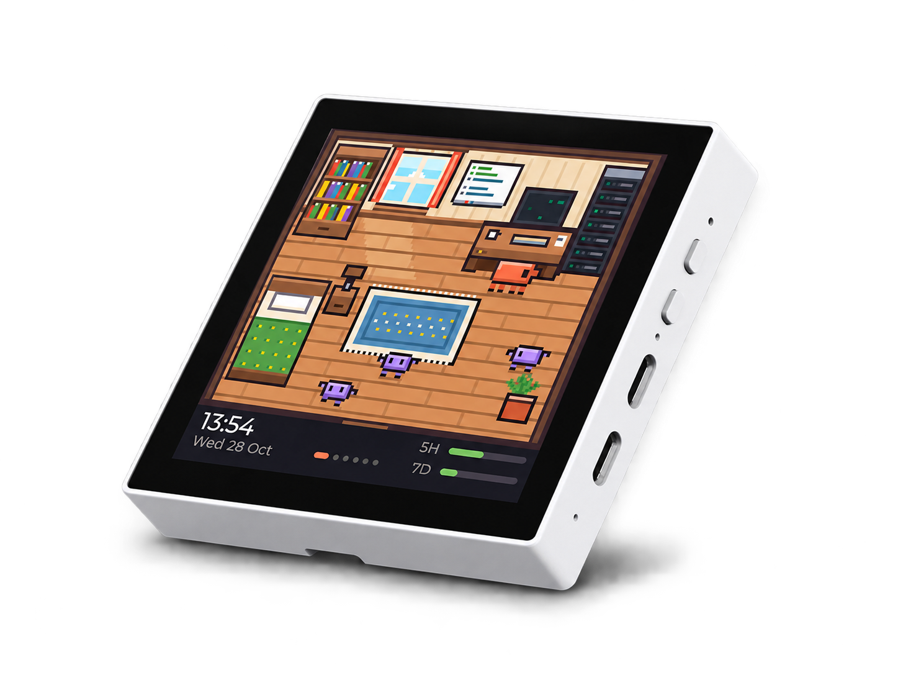
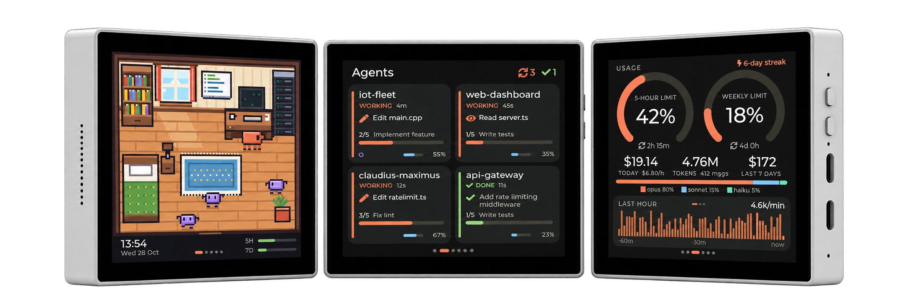
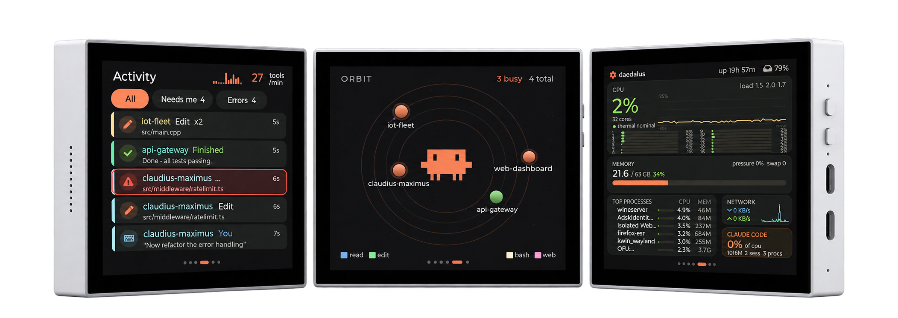

# Claudius Maximus

A desk companion for [Claude Code](https://claude.com/claude-code). A 4" touch screen on your USB port shows every
Claude Code agent running on your machine: which one is working, which one **needs you**, what each agent and
subagent is doing, and how much of your plan is left. Built for people who run several agents in parallel and
want to stop alt-tabbing to check on them.

<p align="center">
  
</p>

Nothing leaves your machine: a small daemon reads Claude Code's local data and talks to the device over the USB
cable. There is no cloud and no account. The only network access is a once-a-day look at this repository's
[Releases page](https://github.com/d-weber/claudius-maximus/releases) for a newer app version (public release
metadata, nothing about you); turn it off with **Check for updates daily** in the menu.

## What you see

Swipe between screens. Tap a session to open its detail view.

- **Home** is Clawd's Studio, a pixel-art room. Clawd walks to the station of whatever your agents are doing:
  desk to write code, bookshelf to read, server rack to run commands, whiteboard to plan, bed when nothing runs.
  Subagents show up as little helpers. When a session needs you, he stands at the door with a big "!". The band
  below is pixel art too: clock, date and the 5-hour / weekly plan gauges, plus the per-model week (FA for Fable).
- **Agents** is one card per session: status, current tool, todo progress, context use, subagents.
- **Detail** shows the selected session's current action, tokens, cost, context, model and todos, with a
  **Focus** button that brings its terminal to the front.
- **Activity** is a live feed of tool calls, prompts, errors and finished turns, filterable to "needs me".
- **Usage** shows your 5-hour and weekly plan limits, today's cost and tokens, the model mix and hourly charts.
- **System** is a btop-style view of CPU, memory, top processes and network.
- **Orbit** draws sessions as planets around Clawd, subagents as moons.

When a session is blocked on a permission prompt or a question, an amber glow lights the edges of the screen and a
"needs you" card appears over whatever you are looking at. When a session finishes, a small celebration plays.
After a few minutes of inactivity the screen dims, then turns into a night clock.

<p align="center">
  
</p>
<p align="center">
  
</p>

## Hardware

- A Waveshare [ESP32-S3-Touch-LCD-4B](https://www.waveshare.com/wiki/ESP32-S3-Touch-LCD-4B): a 4" 480×480 IPS
  panel with capacitive touch and an ESP32-S3 behind it. The older ESP32-S3-Touch-LCD-4 (V4) was supported up to
  firmware 0.3.0 and is not any more.
- A USB-C **data** cable (not a charge-only one).

Plug the cable into the board's **USB-OTG** port, not the "USB TO UART" one. The host link runs over the
ESP32-S3's native USB, and the UART port only works for flashing. The app flashes the firmware for you.

## Install

Download the app for your OS from the [Releases page](https://github.com/d-weber/claudius-maximus/releases). It
bundles the device firmware, so there is nothing else to install. The builds are not code-signed, so each OS warns
once.

| OS | File | Notes |
|---|---|---|
| Windows 10/11 | `ClaudiusMaximus-<ver>-windows-x64.exe` | Per-user installer, no admin rights. On the SmartScreen warning pick **More info → Run anyway**. |
| macOS (Apple silicon) | `ClaudiusMaximus-<ver>-macos-arm64.dmg` | Drag the app to Applications **before** the first launch. Right-click → **Open → Open** to pass Gatekeeper (macOS 15+: open once, then System Settings → Privacy & Security → **Open Anyway**). |
| macOS (Intel) | `ClaudiusMaximus-<ver>-macos-x64.dmg` | Same as above. |
| Linux | `ClaudiusMaximus-<ver>-linux-x64.AppImage` | `chmod +x` and run. Needs FUSE 2 (`libfuse2`, or `libfuse2t64` on Ubuntu 24.04+). Keep the file where it is after the first run. A `.tar.gz` is available if you would rather not use an AppImage. |

Then:

1. **Start the app.** It lives in the menu bar / tray as a small Clawd icon. On first start it installs its hooks
   into `~/.claude/settings.json` (after saving a backup, your own hooks and statusLine are kept) and enables
   **Start at login**. It shows one notification saying what it did.
2. **Plug in the device.** If the board is blank or runs an older firmware, the tray menu offers
   **Install firmware…** or **Update firmware…**. The board reboots and connects by itself within a minute.
3. **Start a Claude Code session.** Hooks apply to sessions started after the install, so restart any running
   ones. The screen updates in real time from there.

The tray icon's badge tells you the state at a glance: grey means no device, green connected, orange flashing
or update available, red error. The menu shows the device, your sessions and plan limits, and lets you reflash,
pick the USB port, toggle start at login or open the log.

**Updates.** When a newer app is on the Releases page the badge turns orange and the menu offers **Update app to
X…**: it downloads the build for your OS, installs it the way you installed it (new AppImage next to the old one,
the Windows installer silently, the .app replaced in Applications) and restarts. **Check for app updates…** asks
right away; `claudius-maximus update` does the same from a terminal (`update --install` installs).

**Several ESP32 boards on your USB?** The app asks each ESP32-S3 port for a hello and uses the one that answers
as Claudius Maximus. A board that does not answer (blank, or running another project) is never picked by itself:
choose it under **Device port** in the menu (or `claudius-maximus port <name>`), then **Install firmware…**.
Flashing always uses the port the app talks to.

### Linux: serial port access

Your user needs write access to the device (`/dev/ttyACM0`). Either add yourself to the `dialout` group and log
back in:

```bash
sudo usermod -aG dialout $USER
```

or install the udev rule from this repo, which also stops ModemManager from grabbing the board:

```bash
sudo curl -fsSLo /etc/udev/rules.d/99-claudius-maximus.rules \
  https://raw.githubusercontent.com/d-weber/claudius-maximus/main/tools/udev/99-claudius-maximus.rules
sudo udevadm control --reload && sudo udevadm trigger
```

GNOME needs the AppIndicator extension to show the tray icon. KDE, Xfce, Cinnamon and most other panels show it as is.

## Plan limits

The 5-hour and weekly plan gauges need a claude.ai Pro or Max login. Claude Code only reports them to its status
line, so the app installs a tiny statusLine wrapper that records them and then runs your own statusLine command,
if you had one. They appear after the first reply in a session.

Per-model weekly limits (the "Fable" week, for instance) never reach the status line, so the daemon also asks the
claude.ai usage endpoint that Claude Code's own `/usage` dialog calls, once every 15 minutes, with the login token
Claude Code keeps in `~/.claude/.credentials.json` (the Keychain on macOS). That row shows up under 5H and 7D on
the home screen. The token is read, never stored or refreshed; to turn this off, put `{"usage_endpoint": false}`
in `~/.claudius-maximus/settings.json` and the row falls back to the snapshot Claude Code caches when you open
`/usage` (shown dimmed once it is more than 12 hours old).

## Uninstall

| OS | |
|---|---|
| Windows | Settings → Apps → **Claudius Maximus** → Uninstall. Removes the hooks, the start-at-login entry and the program. |
| macOS | Quit from the menu bar, then run `"/Applications/Claudius Maximus.app/Contents/MacOS/claudius-maximus" hooks uninstall` and `… autostart disable`, and move the app to the Trash. |
| Linux | Quit from the tray, then run `<AppImage> hooks uninstall` and `<AppImage> autostart disable`, and delete the file. |

Leftover state is in `~/.claudius-maximus` and the log folder (`~/Library/Logs`, `~/.local/state/claudius-maximus`
or `%LOCALAPPDATA%\claudius-maximus`); delete it by hand if you want a clean slate.

## If something does not work

- **Screen says "waiting for host"**: open the tray menu. It says whether the daemon sees the device, and if the
  board is on the wrong USB port.
- **No real-time updates**: restart your Claude Code sessions. If you moved the app or the AppImage, pick
  **Install Claude Code hooks** in the menu again, because the hook command contains the app's path.
- **Plan limits stay unknown**: see Plan limits above.
- **Focus does nothing in VS Code**: on macOS give the app Accessibility permission in System Settings →
  Privacy & Security.

The full troubleshooting table, the command line, the headless install for a source checkout and the internals
are in [docs/DEVELOPMENT.md](docs/DEVELOPMENT.md). The wire protocol is in [PROTOCOL.md](PROTOCOL.md).

## Privacy

Your `~/.claude` data is only read, never modified, except for the hook and statusLine entries merged into
`settings.json` at install time. The only destinations for that data are the device at the end of your USB cable
and, for the plan-limit poll described above, Anthropic's own usage endpoint (your login token goes nowhere else;
see "Plan limits" to turn that poll off).

---

This project was designed and built by a team of Claude Code agents working in parallel.
[docs/TEAM.md](docs/TEAM.md) records how.
