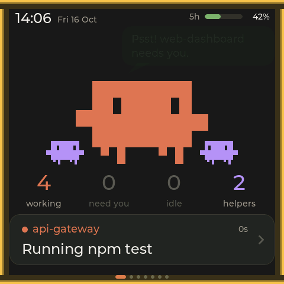
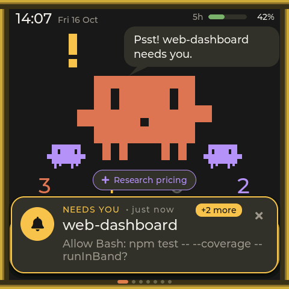
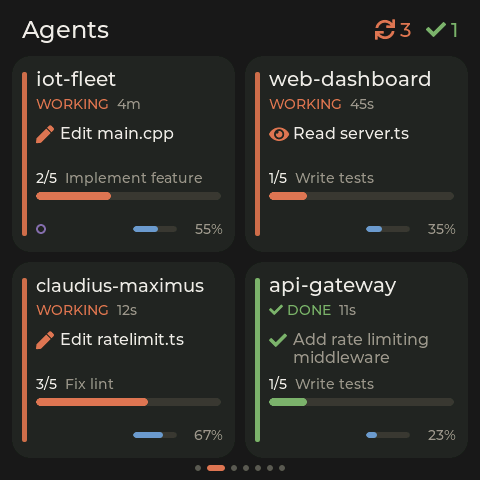
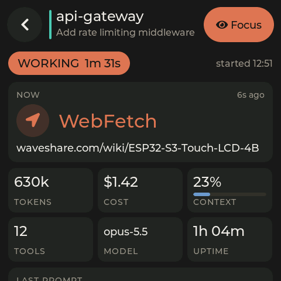
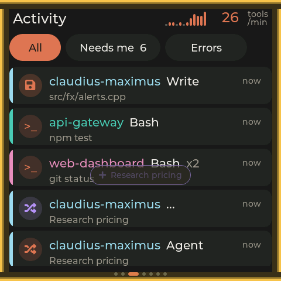
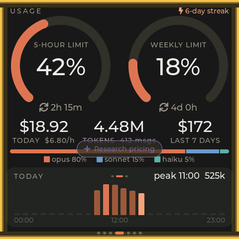
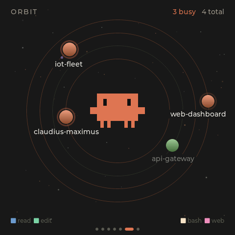

# Claudius Maximus

A desk companion for [Claude Code](https://claude.com/claude-code): a 4" 480×480 touch screen plugged into your
Mac or Linux box over USB that mirrors every Claude Code agent running on the machine. From across the room you can see which
session is working, which one **needs you** (a permission prompt or a question), what each agent and subagent is
doing, and how much of your plan is left.

It is built for developers who run several agents in parallel and want to stop alt-tabbing to check on them.

<p align="center">
  
  
  
</p>

## Screens

Swipe left and right between tiles. Tap any session to open its detail view.

| | |
|---|---|
| **Home**: the Claude mascot reacts to what your agents are doing (working, waiting on you, done, asleep), with the plan limit and the latest activity. | **Agents**: one card per session with status, current tool, todo progress, context use and subagents. |
| **Activity**: a live feed of tool calls, prompts, errors and finished turns, filterable to "needs me" or errors. | **Usage**: 5-hour and weekly plan limits, today's cost and tokens, model mix, hourly and daily charts. |
| **System**: btop-style CPU, memory, top processes, network and the share used by Claude Code. | **Orbit**: sessions as planets around Clawd, with subagents as moons and tool activity as sparks. |
| **Settings**: brightness, auto-dim, screensaver and alert behaviour, stored on the device. | **Detail**: the selected session's current action, tokens, cost, context, model, todos, subagents, and a **Focus** button that brings its terminal to the front on your Mac. |

Alerts appear over any screen: an amber edge glow and a "needs you" card when a session is blocked on you, and a
small celebration when one finishes. After a few minutes of inactivity the screen dims, then turns into a night clock.

<p align="center">
  
  
  
  
</p>

## How it works

```
 Claude Code sessions ──hooks (unix datagram)──┐
 ~/.claude transcripts + session registry ─────┤
 statusLine JSON (plan limits) ────────────────┼─> companion daemon ──USB serial, JSON lines──> device
 host metrics ─────────────────────────────────┘        (launchd)   <── actions (focus a session)
```

- A small **Python daemon** on the host (`host/companion`, macOS or Linux) reads Claude Code's local data and
  receives real-time hook events. It sends the device a state snapshot whenever something changes, plus partial updates and events.
  A permission prompt shows up on the screen within about 50 ms. The daemon uses about 1 % CPU.
- The **firmware** (`firmware/`) is an LVGL 8 UI on the ESP32-S3. It only renders what the daemon sends; nothing
  leaves your machine except over the USB cable.
- The wire format is documented in [PROTOCOL.md](PROTOCOL.md).

Your `~/.claude` data is only read, never modified, and only ever sent to the device over USB.

## Hardware

- [Waveshare ESP32-S3-Touch-LCD-4](https://www.waveshare.com/wiki/ESP32-S3-Touch-LCD-4), **V4** board revision
  (ESP32-S3R8, 8 MB PSRAM, 16 MB flash, ST7701 480×480 RGB panel, GT911 touch, CH32V003 IO expander).
- A USB-C data cable to your Mac or Linux machine.

Only the screen and touch panel are used; the board's buzzer, SD card, RTC, IMU, RS485 and CAN are left alone.

## Setup

Requirements: macOS or Linux, Python 3.12+, Claude Code. [PlatformIO](https://platformio.org/) is installed into
the project venv below (or use your own: `brew install platformio` / `pipx install platformio`).

**1. Flash the firmware** (plug in the board first):

```bash
python3 -m venv host/.venv && host/.venv/bin/pip install -r host/requirements.txt platformio
host/.venv/bin/python tools/dev.py flash
```

On Linux your user needs write access to the serial port (`/dev/ttyACM0`): either `sudo usermod -aG dialout $USER`
(log out and back in) or install the udev rule, which also keeps ModemManager away from the board:

```bash
sudo cp tools/udev/99-claudius-maximus.rules /etc/udev/rules.d/ && sudo udevadm control --reload && sudo udevadm trigger
```

**2. Install the host side:**

```bash
tools/install.sh
cd host && .venv/bin/python -m companion status
```

`install.sh` is idempotent, so you can re-run it after an update or after moving the repo. It:

1. creates `host/.venv` with `pyserial` (and `psutil`, used by the System screen);
2. merges async hooks and a statusLine wrapper into `~/.claude/settings.json`, after saving a timestamped backup
   (`settings.json.bak-claudius-*`). Your own hooks are left untouched, and an existing statusLine command keeps
   working because the wrapper runs it and prints its output;
3. installs the background service: on macOS the LaunchAgent `~/Library/LaunchAgents/com.claudius-maximus.daemon.plist`
   (RunAtLoad, KeepAlive), on Linux the systemd user unit `~/.config/systemd/user/claudius-maximus.service`
   (enabled, restarts on failure).

Options: `--no-service`, `--no-hooks`, `--no-statusline`. Hooks apply to Claude Code sessions started after
the install.

To remove everything: `tools/uninstall.sh [--keep-logs]`. It stops the daemon, removes only our entries from
`settings.json` (restoring your previous statusLine) and deletes `~/.claudius-maximus`.

## Usage

```bash
cd host
.venv/bin/python -m companion status [--json]  # daemon, device, hooks, sessions, plan limits
.venv/bin/python -m companion                  # run in the foreground (stop the LaunchAgent first)
.venv/bin/python -m companion --dry-run        # print the JSON stream instead of using the device
.venv/bin/python -m companion --demo           # stream fake sessions to the device
.venv/bin/python -m companion focus 969ca7a9   # raise the terminal running that session
```

Other flags: `--port /dev/cu.usbmodemXXX`, `--log [FILE]`, `--seconds N`, `-v`.

Daemon control:

```bash
# macOS
launchctl kickstart -k gui/$(id -u)/com.claudius-maximus.daemon   # restart
launchctl bootout gui/$(id -u)/com.claudius-maximus.daemon        # stop
# Linux
systemctl --user restart claudius-maximus
systemctl --user stop claudius-maximus
```

State lives in `~/.claudius-maximus/` (socket, status.json, statusline.json, locks). Logs go to
`~/Library/Logs/claudius-maximus.log` on macOS and `~/.local/state/claudius-maximus/claudius-maximus.log` on Linux,
rotated at 1 MB × 3.

## Details

- **Providers** (`host/companion/providers/`): `sessions` reads `~/.claude/sessions/<pid>.json` and the
  transcripts; `usage` computes tokens, cost and plan limits; `system` collects host metrics; `hooks` receives
  real-time signals. Whichever source saw the most recent status change wins, and events are de-duplicated.
- **Hooks** (`host/hooks/cm_hook.py`): Claude Code runs this tiny script on 14 events (SessionStart/End,
  UserPromptSubmit, Pre/PostToolUse, PostToolUseFailure, PermissionRequest, PermissionDenied, Notification, Stop,
  StopFailure, SubagentStart/Stop, PreCompact). It sends one ≤ 2 KB datagram to `~/.claudius-maximus/hooks.sock`,
  never prints, always exits 0 and does nothing if the daemon is down. Most hooks run `async`; the end-of-turn ones
  (Stop, StopFailure, SessionEnd, SubagentStop) run synchronously, about 30 ms each.
- **statusLine wrapper** (`host/hooks/cm_statusline.py`): saves the plan-limit data Claude Code gives the status
  line (`rate_limits.five_hour/seven_day`, Pro/Max only) to `~/.claudius-maximus/statusline.json`, then runs your
  previous statusLine command.
- **Focus action**: tapping Focus on the device raises that session's terminal. On macOS, Terminal.app and iTerm2
  get the exact tab (matched by tty); VS Code, Cursor and similar get the window whose title has the project name
  (needs Accessibility permission); tmux panes are selected; other terminals are just activated. On Linux, tmux
  panes are selected too, then the window of the terminal process (or, for VS Code and similar, the window titled
  with the project name) is raised through KWin's D-Bus scripting on KDE (X11 and Wayland, nothing to install) or
  `kdotool`, `xdotool` or `wmctrl` where one of them is installed.
- **Device sharing**: the serial port is opened only while holding a flock on `<repo>/.devlock`, the same lock
  `tools/dev.py` uses, and the daemon steps aside while a dev command wants the device. After an unplug, replug
  or reflash it re-sends the full state.

## Troubleshooting

| Symptom | Check |
|---|---|
| Device stuck on "waiting for host" | Run `companion status`: is the daemon running and the port found? `device lock held by another tool` means a `tools/dev.py` command is using the device. |
| Linux: `cannot open device: ... Permission denied` | Add yourself to `dialout` or install `tools/udev/99-claudius-maximus.rules` (see Setup). |
| Linux: device disconnects right after plugging in | ModemManager is probing the port; the udev rule above stops it. |
| No real-time updates | `status` should show hooks `installed=yes listening=yes received>0`. Restart Claude Code sessions after installing; `/hooks` in Claude Code lists them. |
| Plan limits unknown | They need a claude.ai Pro/Max login and the statusLine wrapper, and appear after the first reply in a session. |
| "another companion daemon is already running" | The LaunchAgent is running; stop it before running in the foreground. |
| Focus does nothing in VS Code | macOS: give Accessibility permission to the daemon's Python, or to osascript, in System Settings → Privacy & Security. Linux outside KDE: install `xdotool` (X11) or `kdotool`. |
| Shifted or flickering lines on the panel | Rebuild with `-DHAL_BOUNCE_PX=19200` in `firmware/platformio.ini` (restores bounce buffers, slower). |
| Logs | `tail -f ~/Library/Logs/claudius-maximus.log` (macOS) / `~/.local/state/claudius-maximus/claudius-maximus.log` (Linux), or run in the foreground with `-v`. |

## Development

```
PROTOCOL.md                 host ⇄ device protocol (source of truth for data)
firmware/                   PlatformIO, Arduino-ESP32 3.x, LVGL 8.4, ArduinoJson 7
  src/core/                 display/touch HAL, state model, serial link, settings, perf probe
  src/ui/                   tile manager, theme (palette, fonts, status colours)
  src/screens/              one file per screen
  src/fx/                   alerts overlay, auto-dim / screensaver / night clock
host/companion/             Python daemon and data providers
host/hooks/                 Claude Code hook + statusLine wrapper
host/launchd/, host/systemd/  background service templates (macOS LaunchAgent, Linux systemd user unit)
tools/                      dev.py (build/flash/screenshot/perf), install/uninstall, bench, udev rule
iso-clawd/                  WIP: isometric Clawd animation prototypes (browser only)
docs/                       PERF.md (measurements), STATUS.md, TEAM.md (how the agent team worked)
```

`tools/dev.py` drives the device during development (set `DEV_NAME` for a private build directory):

```bash
host/.venv/bin/python tools/dev.py build
host/.venv/bin/python tools/dev.py flash
host/.venv/bin/python tools/dev.py shot out.png --screen agents [--detail] [--alert waiting]   # framebuffer PNG with demo data
host/.venv/bin/python tools/dev.py perf --screen orbit                                          # fps, frame time, CPU, heap
```

This project was designed and built by a team of Claude Code agents working in parallel;
[docs/TEAM.md](docs/TEAM.md) and [docs/PERF.md](docs/PERF.md) record how.
